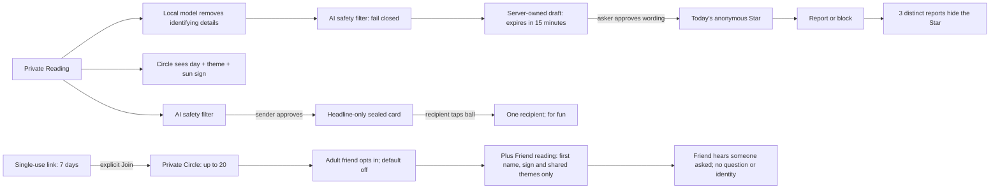

# Social boundary

Tonight’s Sky is public. Circles and sealed forecasts are private. Publishing always needs an explicit approval.

| Data | Access and invariant |
| --- | --- |
| `social_profiles` | Own profile only. Lowercase sun sign; teen/adult/unknown. Friend consent can only be enabled for adults. Plus is server-owned, with an explicit loopback-only mock entitlement boundary for the prototype. |
| `social_drafts` | Trusted moderation service writes only; clients cannot insert or edit. Contains rewritten wording, theme and owner, never the original question. A draft is scoped to star/seal, its owner and a 15-minute lifetime. |
| `sky_stars`, `sky_resonances` | One Star per person/UTC day. Public RPC exposes wording, theme, resonance counts and own flags; no author ID. A second publication that day is refused, including after withdrawal; existing wording, resonance and reports stay attached to the original Star. |
| `star_reports`, `social_blocks` | One report per account/Star; three accounts auto-hide. Block resolves a public Star's author server-side, keeping identity out of the public response. Blocking applies both directions to social visibility and Friend reading authorization. |
| `circles`, `circle_members`, `circle_invites`, `circle_reactions` | Up to 20 members, all by single-use 7-day invitation. Joining consents to sharing future consultation day/theme and sun sign. No question or forecast. Fixed star reactions only. Leaving removes access. The creator can close the Circle. |
| `friend_notices` | Recipient alone sees that someone asked, and the day; no asker or question stored. Friend consent, membership, blocking and Plus are checked at generation time. |
| `sealed_forecasts` | Moderated headline only; never question, answers or Why. Sender can revoke. Recipient claims by tapping; row lock allows only one claimant. Free: one per UTC calendar week, including revoked cards. Plus: unlimited. Cards do not expire; only invitations expire after seven days. |

All tables have RLS. Security-definer functions pin an empty search path, explicitly qualify schemas, and revoke public/anon execution. Service-only moderation receipts prevent clients bypassing the AI filter. Public words are rewritten and approved, never the raw question. Every newly published user line passes the local model safety filter; deterministic sensitive-topic rules are shared with the reading engine. Seeds are controlled app content, `synthetic: true`, visibly labeled “Sample stars” and excluded from real counts.

The profile integration reads the account's `sunSign` and `ageBand` fields, owned by the reading-flow worker. The account owns `birthday`; it is not shared or used to override a null `ageBand`. Missing age uses teen safeguards. Both shared draft kinds use teen-audience moderation because the audience can include teens, regardless of sender age. Social code does not collect birthdays, birth time, place or location.

## Proof and limits

`bash scripts/verify-social-db.sh` creates and removes its own PostgreSQL cluster, loads the actual migrations, and runs roles and policies as separate users. It tests draft ownership, direct-write rejection, anonymous projection, invite replay/expiry, Circle capacity, leaving, consent defaults/teen constraints, friend notice privacy, reports, blocks, weekly seals, and concurrent recipient claims. The auth schema is a minimal Supabase stub: this proves PostgreSQL RLS, not Supabase Auth or PostgREST interoperability.

For UI verification, `SOCIAL_DB_SERVE=1 bash scripts/verify-social-db.sh` leaves that same isolated cluster running behind `scripts/social-dev-transport.mjs`. The transport simulates Auth/PostgREST on loopback only, while SQL, RLS, app code and Ollama are real. It is verification tooling, never a production fallback. No Docker, hosted accounts or paid services are needed.

Anonymous-account reports are not proof of distinct humans. Hosted rate limits, anti-abuse controls, verified subscription entitlements and native delivery remain deployment boundaries. No real billing is enabled by this feature.

Detailed executable boundary proof and remaining integration risks: [blast radius evidence](../evidence/social-blast-radius.md). Browser privacy journey: [social drive](../evidence/social-drive.json). Real-model sample moderation: [model sample](../evidence/social-model.json).

## Accepted v1 social semantics

The requester enters a local nickname for a selected Circle member. It is not a verified identity: consent, sign, activity themes and the anonymous notice stay bound to the selected member ID. “Someone asked about you” records an authorized attempt, including one later cancelled or refused; it does not promise that a forecast was delivered.

Age is client-declared in v1, not independently verified. Onboarding and its birthday gate belong to the reading-flow feature. Missing age remains teen-safe, friend consent stays off unless the profile is adult, and shared drafts always use teen-audience moderation.

Blocking prevents either account from resonating with or reporting the other's Stars, even with a retained Star ID. Existing reactions and reports stay stored for audit but do not affect public totals across that block. A handled invitation is removed from the route after join or decline so navigation and reload cannot replay the prompt.
