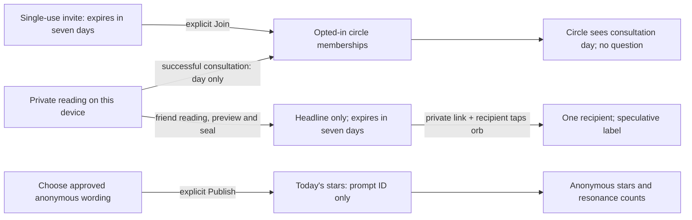

# Social boundary

Tonight’s Sky is public, Circles are private, and every publication is deliberate.
No change to the reading engine, saved predictions, credit accounting, or knowledge bank.

| Stored shape | Access and invariant |
| --- | --- |
| `sky_stars(id, user_id, prompt, day)` | Owner can remove. One per owner/day. Public RPC returns ID, approved prompt, resonance count and own reaction only; never user ID. Raw question text cannot be stored. |
| `sky_resonances(star_id, user_id)` | One per viewer/star; counts via public RPC. |
| `circles(id, owner_id)` | Only members see the group. Maximum eight members. No names or free-text bios. |
| `circle_members(circle_id, user_id, joined_at, consulted_on)` | Joining consents to sharing future consultation days. No historical backfill. Leaving removes that visibility. |
| `circle_invites(token, circle_id, expires_at)` | Owner creates one-use invitations; joining locks the invitation and circle to prevent replay/overfilling. Link possession alone never joins. |
| `circle_reactions(circle_id, target_id, user_id, day)` | Members can send one star per person/day; no text. |
| `sealed_forecasts(id, sender_id, recipient_id, token, headline, expires_at, opened_at)` | Sender can revoke. Recipient claims atomically by tapping; sender cannot claim own link. Only headline is sent, never question, facts or Why. Unopened text is not queryable by recipients. |

All tables have RLS. Narrow RPCs authenticate via `auth.uid()`; definer functions use an empty search path and explicit schema names. Public/anon execution is revoked. Direct client writes cannot evade membership, time or allowlist checks. Sky uses approved wording rather than trying to remove names from arbitrary text. Sensitive-topic phrase redirects are reused before social publication and when rendering sealed content; no raw text from strangers is rendered in the sky.

Seeds exist only in app data with `synthetic: true`, labeled “Sample stars” and excluded from real counts. Offline browsing still works; publishing, invites and seals require the configured local Supabase. No simulated friendship success or local-only link pretending to work for another person.

Verification must include two authenticated users plus an outsider: anonymous field projection, cross-user RLS rejection, invite replay/expiry, membership revocation, recipient claim races, sealed payload privacy, and reloading persisted state. Native link delivery remains a device check.
