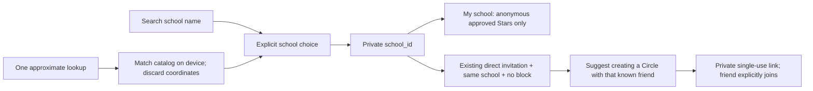

# School Sky and Circle suggestions

School is optional and self-selected. Only `social_profiles.school_id` is saved to an account. RLS exposes that column to its owner only. `set_school` accepts a catalog ID or null; it cannot change age, consent, Plus, or another profile. Profile synchronization preserves the selection.

## Catalog boundary

`schools` is a small seeded catalog of three San Francisco public high schools: Lowell, George Washington, and Abraham Lincoln. Names correspond to [SFUSD's school directory](https://www.sfusd.edu/schools/school-directory); positions are approximate campus coordinates rounded to two decimals, for coarse ranking only. This is manually seeded starter coverage, not a downloaded district dataset or global search service. The directory blocked automated fetching during verification. No paid API, geocoder, or user-location request goes to a third party. Expand this one table with an appropriately licensed dataset when coverage warrants it; no additional discovery surface is implied.

The picker states the limited coverage and lets people search, skip, change, or remove their school. Nearby ranking uses only a transient position rounded to tenths of a degree and a 50 km radius. It returns school rows, never coordinates representing the user. The location prompt (native, or browser geolocation on web) is offered once per installation after an explicit tap; only a non-location “asked” marker is stored locally, even after denial. Denial or an unavailable sensor falls back to search.

## Visibility and safeguards

`tonights_sky(my_school => true)` matches the viewer's saved school before the 200-Star limit. A missing school gives an empty result. The existing anonymous response, daily visibility, reports and bidirectional blocking apply unchanged. School mode never mixes sample Stars into real school activity. Exams, prom and crush questions remain anonymous wording in the existing Learning, Growth and Love themes, under the existing AI moderation gate.

Suggestions use current Circle owner/member pairs: only the owner can issue invitations, so this proves a direct accepted invitation. Two fellow members are not inferred to know one another. A suggestion identifies an already-visible Circle friend who chose the same school; it does not list school strangers. Starting a suggested Circle creates an ordinary private invitation for manual sharing. Repeating the action while the social screen remains mounted reopens that account/school/friend's cached invitation if it is unexpired, still owned by the caller, and its Circle has no other members; otherwise it creates a new Circle and invitation. It never adds someone automatically, exposes other Circles, or bypasses joining consent. Leaving the original Circle removes that relationship's suggestion. Blocks suppress suggestions in both directions. No historical invite backfill or relationship table is needed.

School affiliation is self-declared, not verified enrollment. Choosing a school explains that anonymous Stars can enter its sky and known invited friends can see school suggestions. No public school member directory exists. Teen and unknown-age friend-reading consent stays off; school selection never promotes age or grants consent. Moderation is unchanged.

## App Store privacy and native release note

The foreground purpose string explains the one-time approximate lookup and school-only storage. iOS defaults to reduced accuracy (`NSLocationDefaultAccuracyReduced`); there is no precise-accuracy upgrade or Always permission. Android blocks `ACCESS_FINE_LOCATION` and `ACCESS_BACKGROUND_LOCATION`, retaining only coarse foreground permission. There are no location watchers, analytics events, logs, server calls, or persisted coordinates.

For privacy-label preparation: the app processes coarse location ephemerally on device for optional school matching. It does not transmit or collect device coordinates for tracking, advertising, or server retention. The selected school is retained and linked to the account for app functionality; disclose that profile information and the school-based social use. Confirm the final App Store questionnaire against the actual production SDKs/data flows at submission. No submission is part of this change. Generated native configuration was checked; device permission-dialog and sensor behavior remain unverified without Xcode/device access.

## Reproduce

Run `npm run check`, `npm test`, and `bash scripts/verify-social-db.sh`. The latter runs both the original social invariants and `scripts/school-rls.sql` on real PostgreSQL. Follow verify-crystal-ball's isolated social setup, then run `node scripts/drive-school.mjs` and the existing social/core drives. Local Auth/PostgREST is a test adapter; it is not proof of hosted Supabase transport.
